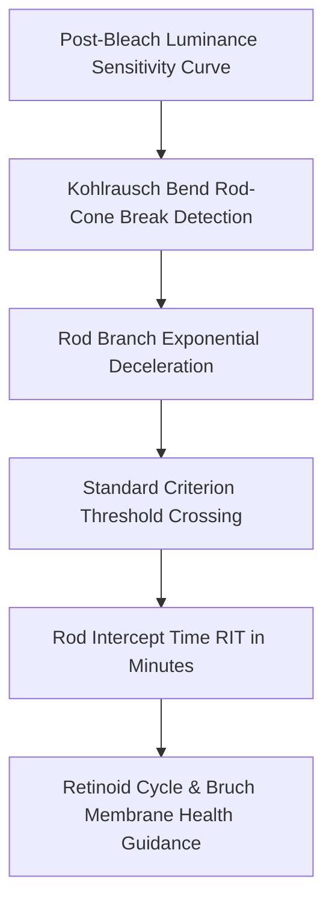

# Ocular Dark Adaptation Rod Intercept Time (RIT) Skill

[](LICENSE)
[](https://www.python.org/)
[](https://openclaw.org/)
[](https://alphapark.ai/)
[](https://modelcontextprotocol.io/)

Retinal Dark Adaptation Kinetics and Rod Intercept Time (RIT) Quantitative Evaluator based on scotopic psychophysical modeling.



## Features
- **Zero PIP Dependencies**: Implemented strictly with Python Standard Library (`math`, `json`, `sys`, `typing`).
- **Biphasic Retinal Modeling**: Distinguishes cone photopic plateau from rod rhodopsin regeneration.
- **RIT Quantitation**: Standard clinical dark adaptometry metric for early nyctalopia and macular screening.
- **Dual Architecture**: Native Python import and Model Context Protocol (MCP) JSON-RPC 2.0 stdio server.

## Quickstart
```bash
python example_usage.py
```

## License
Apache-2.0
